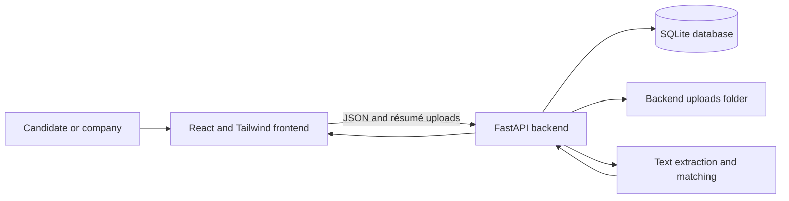

# Resume Shortlisting System — Project Report

**Project type:** Full-stack web application  
**Prepared:** October 2026  
**Technology:** React, Tailwind CSS, FastAPI, SQLite, and scikit-learn

## 1. Abstract

The Resume Shortlisting System connects candidates looking for work with companies
recruiting for open roles. Companies create job descriptions and review
applications. Candidates create accounts, upload résumés, browse jobs, and apply.
The backend extracts text from uploaded PDF, DOCX, and TXT files and compares it
with each job description. The applicant view presents recognized skill matches
and a separate TF-IDF text similarity score to help companies review candidates.

The matching feature is a transparent baseline. It is not a trained hiring model
and does not make hiring decisions.

## 2. Problem and objectives

Recruiters may receive many résumés for one role. Manually comparing every résumé
with a job description takes time, while candidates need a clear way to submit
their information and follow applications. This project aims to:

- Provide separate accounts and workspaces for candidates and companies.
- Let companies publish job descriptions and manage applications.
- Let candidates maintain a résumé, browse roles, and submit applications.
- Extract résumé text and identify job-related skills for comparison.
- Show useful, understandable comparison information to the company.
- Keep candidate and company data scoped to the signed-in account.

## 3. Users and features

### Candidate

- Register and sign in with a candidate account.
- Save a profile résumé without waiting for an open role.
- Choose whether companies may discover that profile résumé for job matching.
- Browse publicly listed jobs and submit a résumé for a particular job.
- View saved résumés and submitted application statuses.
- Download their own résumé files.

### Company

- Register and sign in with a company account.
- Post job titles and descriptions.
- View applicants for jobs owned by that company.
- Find candidates who opted into profile matching, even if they have not applied
  to the company's job.
- Review applicant contact details, recognized skills, skill coverage, and text
  similarity.
- Download application résumés and update status to submitted, reviewing,
  shortlisted, or rejected.

## 4. System architecture



The React frontend runs in the browser and communicates with FastAPI over HTTP.
FastAPI authenticates requests, stores account and application records in SQLite,
stores uploaded files in `Backend/uploads/`, and runs text extraction and matching.

### Main technology choices

| Area | Technology | Purpose |
| --- | --- | --- |
| Frontend | React | Account, candidate, and company pages |
| Styling | Tailwind CSS | Responsive interface styling |
| Backend | FastAPI | Authentication, job, résumé, and matching APIs |
| Database | SQLite | Accounts, jobs, résumé metadata, and statuses |
| Text extraction | pypdf, python-docx, Python text reader | Read PDF, DOCX, and TXT résumés |
| Text similarity | scikit-learn TF-IDF and cosine similarity | Compare job and résumé wording |

## 5. Résumé matching method

When a candidate uploads a résumé, the backend checks the file type and size,
extracts text, and stores the file and extracted text. Candidates can choose to
make a profile résumé discoverable. When a company views candidates for a job,
the backend analyzes direct applications and the latest discoverable profile
résumé for each opted-in candidate against that job's description.

The analysis has two parts:

1. **Recognized skill coverage:** A built-in dictionary maps known skill names
   and aliases, such as `React`/`React.js` or `PostgreSQL`/`Postgres`. The backend
   compares skills found in the job description with skills found in the résumé.
   Coverage is the percentage of recognized job-description skills also found in
   the résumé. It also lists matched skills and job skills that were not detected.
2. **TF-IDF text similarity:** scikit-learn converts the job description and
   résumé text into TF-IDF vectors. Cosine similarity reports how similar their
   wording is. This score is shown separately from skill coverage.

Applicants are ordered by recognized skill coverage when the job description
contains skills from the dictionary, then by TF-IDF text similarity. If no
recognized skills are found in the job description, the interface reports that
skill coverage is unavailable and the text similarity remains available.

These values are comparison aids. A match score is not a probability of being
qualified, a guarantee of performance, or an automatic hiring recommendation.
The recognized skill list is finite and can miss skills, synonyms, context, or
skills expressed in an unusual way. Companies should review the résumé itself.

## 6. Data storage and privacy

- `Backend/shortlist.db` stores users, job posts, résumé metadata, extracted
  résumé text, application statuses, and timestamps.
- `Backend/uploads/` stores the original résumé files.
- Passwords are stored as password hashes.
- Sign-in returns a bearer token that expires after 12 hours.
- Candidate-only and company-only API routes enforce account roles.
- Companies can only see applicants for their own jobs and can access profile
  résumés only when the candidate opted into matching.
- Candidates can list and download their own résumé files.
- Accepted uploads are PDF, DOCX, and TXT, with a 10 MB limit.

The default signing key is for local development. A deployed instance must set a
strong `SHORTLIST_SECRET_KEY`, use HTTPS, and protect database and upload storage.

## 7. Main API routes

| Method | Route | Purpose |
| --- | --- | --- |
| POST | `/api/auth/register` | Create candidate or company account |
| POST | `/api/auth/login` | Sign in |
| GET | `/api/auth/me` | Return signed-in account |
| GET | `/api/jobs` | Browse public jobs |
| POST | `/api/jobs` | Create a job as a company |
| GET | `/api/company/jobs` | List jobs for the signed-in company |
| GET | `/api/candidate/resumes` | List résumés for the signed-in candidate |
| PATCH | `/api/candidate/resumes/{resume_id}/discoverability` | Candidate controls profile résumé sharing for matching |
| POST | `/api/resumes` | Save a profile résumé or apply with a résumé |
| GET | `/api/jobs/{job_id}/matches` | List and compare applicants for a company job |
| PATCH | `/api/jobs/{job_id}/matches/{resume_id}` | Update application status |
| GET | `/api/resumes/{resume_id}/download` | Download an authorized résumé |

Interactive API documentation is available at `http://127.0.0.1:8000/docs` while
the backend is running.

## 8. Running locally on Windows

Open two PowerShell terminals.

### Terminal 1: backend

```powershell
cd "C:\Users\omkar\Desktop\Resume Shorlist\Backend"
py -3.11 -m venv .venv
.\.venv\Scripts\python.exe -m pip install -r requirements.txt
.\.venv\Scripts\python.exe -m uvicorn main:app --reload --host 127.0.0.1 --port 8000
```

If `.venv` already exists, skip the `py -3.11 -m venv .venv` line.

### Terminal 2: frontend

```powershell
cd "C:\Users\omkar\Desktop\Resume Shorlist\Frontend"
npm install
npm run dev
```

Open the local address Vite prints, normally `http://localhost:5173`. Keep both
terminals running while using the application.

## 9. Verification performed

- Frontend ESLint completed successfully.
- Frontend production build completed successfully.
- Backend Python syntax compilation completed successfully.

These checks confirm code quality and compilation; they are not a full
end-to-end deployment or hiring-quality evaluation.

## 10. Current limitations and future improvements

- The skill dictionary covers a selected set of common skills; it needs broader
  coverage and careful maintenance for different industries.
- TF-IDF measures word overlap and does not understand meaning as well as a
  semantic language model.
- There is no labeled hiring dataset, model training pipeline, or model-quality
  evaluation in the project.
- PDF extraction can fail or lose structure for scanned or complex documents.
- The application does not currently provide email verification, password
  recovery, or production cloud storage.

Possible future work includes adding editable skill requirements to job posts,
using a validated semantic model, evaluating results with representative and
consented data, adding candidate profile fields, and adding deployment-grade
storage, monitoring, email verification, and password recovery.

## 11. Conclusion

The project provides the core workflow for a two-sided résumé shortlisting
application: companies publish roles and review applicants, while candidates
upload résumés and apply. Its current matching combines transparent skill
coverage with TF-IDF text similarity. It is suitable as a learning prototype;
its rankings should support human review rather than replace it.
